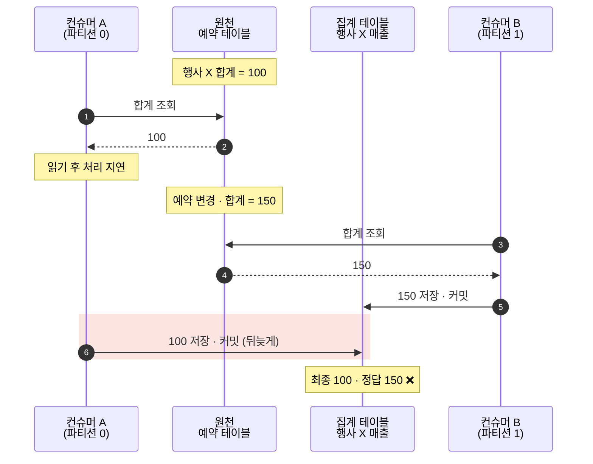
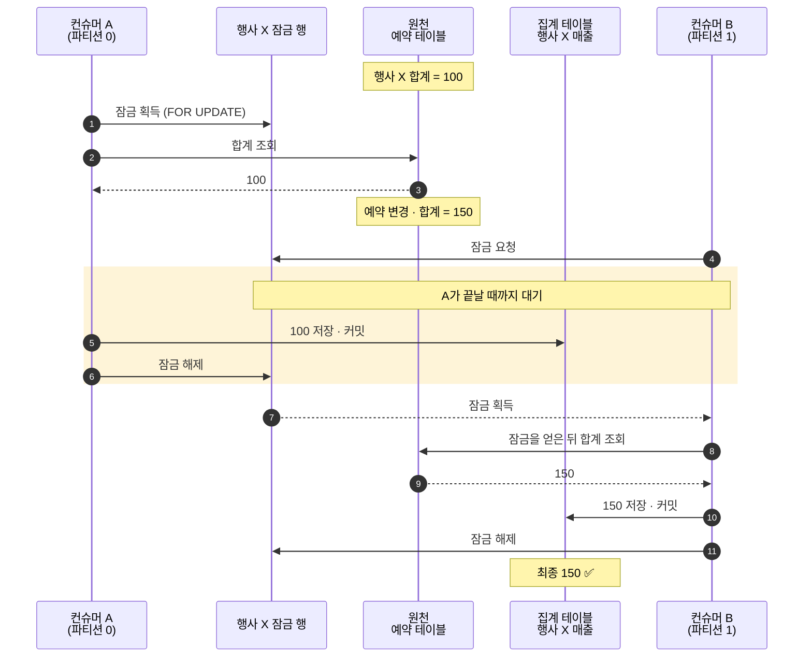

# retro-kafka-statistic

실무에서 만든 **CDC → Kafka → 집계** 파이프라인을 회고하며, 재직 중 발견했지만 해결하지 못한 **stale write**를 직접 재현하고 막아 본 실습 저장소.

> - **원천 재조회 + 절대값 upsert**로 중복 처리는 견딜 수 있었지만, 같은 집계 row를 두 경로가 동시에 쓰면 옛 값이 최신값을 덮을 수 있었다.
> - 실무의 경합 경로는 **Lambda ↔ 복구 쿼리**였다. 랩에서는 집계를 **예약의 부모 모델인 행사 단위**로 넓혀 컨슈머 간 경합도 재현했다.
> - 재계산을 잠금으로 직렬화하는 것만으로는 부족했다. **잠금 전에 스냅샷이 만들어지지 않아야 하고, 모든 쓰기 경로가 같은 잠금 규칙을 따라야 했다.**

Kafka 1대(KRaft) · MySQL 8.4 · Python(confluent-kafka, PyMySQL)

---

## 1. 전체 아키텍처

예약 변경을 대시보드에 반영하기 위해, 예약별 집계 row를 원천 기준으로 다시 계산해 저장하는 파이프라인이었다.

예약 변경 → DMS(CDC) → Kafka(MSK) → Lambda → 원천 재조회 → 집계 저장

별도 복구 쿼리도 원천을 재조회해 같은 집계 row를 갱신했다.

설계의 중심은 두 가지였다.

- **이벤트는 “바뀌었다”는 알림으로만 쓴다.** 페이로드 값으로 집계하지 않고 원천을 다시 읽는다.
- **증분 가감이 아니라 절대값으로 덮어쓴다.** 같은 원천 상태에서는 여러 번 처리해도 같은 값이 된다.

이 설계라면 이벤트가 중복되거나 순서가 바뀌어 도착해도, 집계는 원천 DB의 현재 상태로 수렴한다고 생각했다.

### 이 랩으로 옮긴 방식

**행사는 여러 예약을 묶는 부모 모델이다.** 하나의 행사에 여러 예약이 속한다. 실무에서는 예약별로 집계 row를 저장했지만, 랩에서는 같은 행사에 속한 예약들의 금액과 건수를 하나의 집계 row로 모았다.

| 실무 | 랩 |
| --- | --- |
| 예약 단위 집계 row | 행사(`event_code`) 단위 집계 row |
| 파티션 키 = 예약 ID | 동일 |
| 파티션별 Lambda | [워커 2개](app/aggregate.py) |
| 별도 복구 쿼리 | [복구 배치](app/recover.py) |
| MariaDB | MySQL 8.4 |

실무에서는 컨슈머들이 서로 다른 예약 row를 썼지만, **Lambda와 복구 쿼리는 같은 예약 row를 쓸 수 있었다.**

랩에서는 같은 행사의 예약이 서로 다른 파티션으로 나뉘면서, **컨슈머끼리도 같은 집계 row를 동시에 재계산**할 수 있게 된다.

사전 실험에서는 다음을 확인했다. 상세 기록은 [notes/results.md](notes/results.md)에 있다.

- **C1:** 같은 행사의 예약이 서로 다른 파티션으로 나뉘어, 컨슈머 간 경합이 가능한 조건을 확인했다.
- **C2:** DB 반영 후 오프셋 커밋 전 크래시로 12건을 재처리해도, 절대값 upsert로 중복 누적 없이 집계가 일치했다.

## 2. 문제 원인

**stale write**는 오래된 읽기에 근거한 쓰기가 더 최신의 쓰기를 덮어쓰는 것이다.

원천 재조회는 **읽는 시점의 값**을 가져올 뿐, 그 값을 나중에 쓸 때도 최신이라는 보장은 없다.

### 실패: 늦게 끝난 작업이 옛 값으로 덮는다

아래는 랩에서 같은 행사 X를 재계산하는 두 컨슈머의 흐름이다.

워커 2개로 재현한 결과, **누락 0 · 재처리 0 · lag 0인데도 집계는 MISMATCH**였다.

### 어떤 조건에서 문제가 되는가

복구 쿼리가 실행되는 동안 같은 예약이 바뀌거나, 배치 처리로 읽기와 쓰기 사이가 벌어지면 경합이 생길 수 있다. 랩에서는 `--hold-after-read-ms`로 그 간격을 늘려 재현했다.

문제는 **컨슈머 지표만으로 발견하기 어렵다는 것**이다. 다음 변경 이벤트가 오면 바로잡힐 수 있지만, 더 이상 변경되지 않는 예약이라면 틀린 값이 계속 남는다.

## 3. 해결 과정

해결 조건은 세 가지였다.

- **집계 키별로 재계산을 직렬화한다.**
- **잠금 전에 일반 조회로 스냅샷을 만들지 않는다.**
- **컨슈머와 복구 배치가 같은 잠금 규칙을 따른다.**

### 3-1. 비관적 잠금 선택

랩의 컨슈머 간 경합만 고려하면, 파티션 키를 행사로 맞춰 같은 행사의 재계산을 한 컨슈머에서 순서대로 처리할 수도 있다. 하지만 실무의 **Lambda ↔ 복구 쿼리 경합은 Kafka 밖의 쓰기 경로를 포함**하므로, 파티션 키 변경만으로 해결할 수 없다.

낙관적 잠금도 검토했다. 다만 낡았는지 판단해야 하는 대상은 집계 row뿐 아니라 **집계에 사용한 원천 읽기**였다. 실무에서는 원천 데이터가 여러 테이블에 흩어져 있어 단일 버전을 정의하기 어렵고, 충돌 시 재시도도 필요했다.

따라서 **같은 집계 키의 재계산을 비관적 잠금으로 직렬화**했다. 컨슈머와 복구 쿼리가 같은 규칙을 적용할 수 있다는 점도 선택 이유였다.

### 3-2. 해결: 집계 키별 잠금 후 원천 조회

집계 키마다 제어 행(`event_lock`)을 두고, 원천을 읽기 전에 `SELECT … FOR UPDATE`로 잠갔다.

집계 row 자체를 잠그지 않은 이유는 **집계가 아직 없는 새 키에도 잠글 대상이 필요했기 때문**이다.

실험에서는 뒤 작업이 앞 작업의 커밋까지 대기한 뒤, 원천을 다시 읽어 올바른 집계를 저장했다.

A도 잠시 100을 쓴다. 잠금이 보장하는 것은 항상 최신인 값이 아니라 **재계산의 순서**다. 원천 변경마다 이벤트가 도착하고, 뒤 작업이 **잠금을 얻은 뒤 다시 읽기** 때문에 최종 결과가 맞는다.

### 3-3. 잠금을 걸었는데도 옛 값을 읽었다

잠금 전에 일반 조회를 한 경로에서는, 잠금을 기다린 뒤에도 옛 값을 읽어 최신 집계를 덮었다.

원인은 **REPEATABLE READ의 스냅샷**이었다. 트랜잭션의 첫 일반 SELECT에서 만들어진 스냅샷을 이후 원천 조회도 사용했다. 잠금을 얻었다고 기존 스냅샷이 갱신되지는 않았다.

> 잠금 전 일반 조회로 스냅샷 생성 → 잠금 대기 → 잠금 획득 → 원천을 다시 조회해도 옛 스냅샷 사용 → stale write

이를 막기 위해 **잠금 획득을 트랜잭션의 첫 조회로 두었다.**

READ COMMITTED에서도 해당 시나리오가 해결되는 것을 확인했다. 다만 격리 수준은 세션·DB 설정이라 적용을 놓칠 수 있어, 이 랩에서는 **코드로 조회 순서를 강제하는 방식**을 선택했다.

### 3-4. 복구 배치도 같은 잠금 사용

컨슈머에만 잠금을 적용하고 복구 배치는 그대로 두자, **복구 배치가 옛 값으로 집계를 덮었다.**

복구 배치도 [`recompute_event(lock=True)`](app/db.py)를 거치도록 수정한 뒤 결과가 일치했다.

같은 row를 쓰는 경로 하나만 잠금 규칙에서 빠져도 보호가 깨진다. 그래서 잠금과 재계산을 같은 함수에 모았다.

stale write 시나리오는 [app/stale.py](app/stale.py)에서 두 트랜잭션의 실행 순서를 고정해 재현했다.

## 4. 결과

### Before / After

| 상황 | Before | After |
| --- | --- | --- |
| 두 작업이 같은 집계 row를 재계산 | 잠금 없음 → **STALE** | 잠금을 첫 조회로 적용 → OK |
| 워커 2개 + Kafka | 누락·재처리·lag 모두 0인데 **MISMATCH** | 잠금 사용 → 대기 후 OK |
| 잠금 전에 일반 조회 | 옛 스냅샷으로 **STALE** | 잠금을 첫 조회로 변경 → OK |
| 복구 배치가 함께 쓰는 경우 | 복구 배치가 잠금 없이 실행 → **STALE** | 같은 잠금 함수 사용 → OK |
| 잠금 대기가 길어지는 경우 | — | 타임아웃 시 오프셋 커밋 없이 정지 → 재기동 후 OK |

누락·재처리·lag가 모두 0이어도 집계는 틀릴 수 있었다. 따라서 이 랩에서는 처리 지표와 별개로, **원천에서 독립 계산한 기대값과 실제 집계를 대조해 정합성을 확인했다.** 검증 코드는 [app/verify.py](app/verify.py)에 있다.

실험별 조건과 상세 결과는 [notes/results.md](notes/results.md)에 정리했다.

### 비용과 한계

- **같은 키의 처리량이 제한된다.** 같은 행사로 변경이 몰리면 재계산이 직렬화된다.
- **잠금 대기 중에도 DB 연결을 점유한다.**
- **잠금을 얻지 못하면 처리를 멈춘다.** 잠금 대기 타임아웃에 걸리면 오프셋을 커밋하지 않고 정지한다. 실험에서는 재기동 후 미커밋 구간을 재처리해 집계가 일치했다. 정합성을 지키는 대신 지연을 감수한 것이다.
- **MariaDB에서의 동작 차이는 검증하지 않았다.** 랩은 MySQL 8.4를 사용했다.

잠금 도입 중에는 예상하지 못한 영향도 있었다. 발행기에서 제어 행을 보장하려고 `INSERT IGNORE INTO event_lock`을 실행했더니, **이미 존재하는 행에도 공유 잠금을 요청하면서 업무 쓰기가 집계 작업의 잠금에 30초 동안 막혔다.**

이미 있는 제어 행은 잠금 없는 SELECT로 먼저 확인하고, 없을 때만 INSERT하도록 바꿨다 ([app/db.py](app/db.py)). 집계 작업끼리만 직렬화하려던 잠금이 원천 쓰기에까지 영향을 줄 수 있음을 확인한 사례였다.

