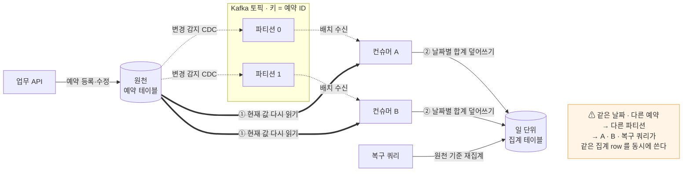
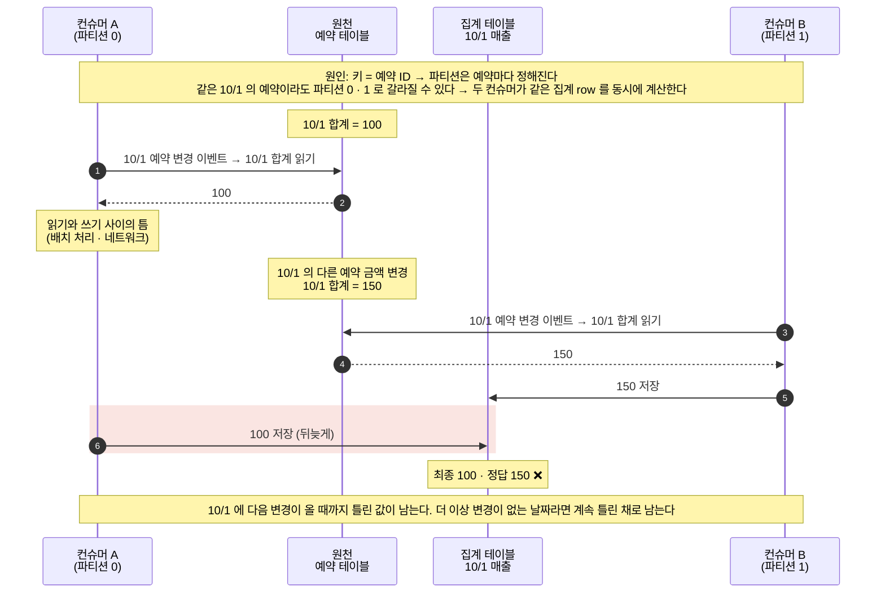
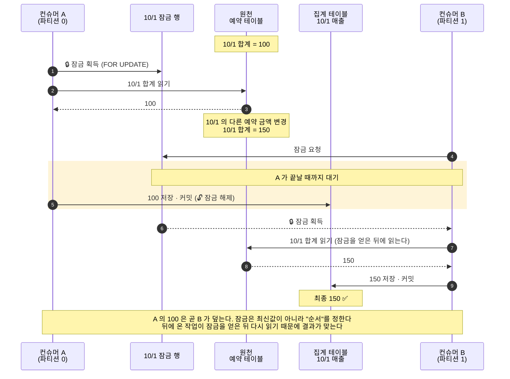
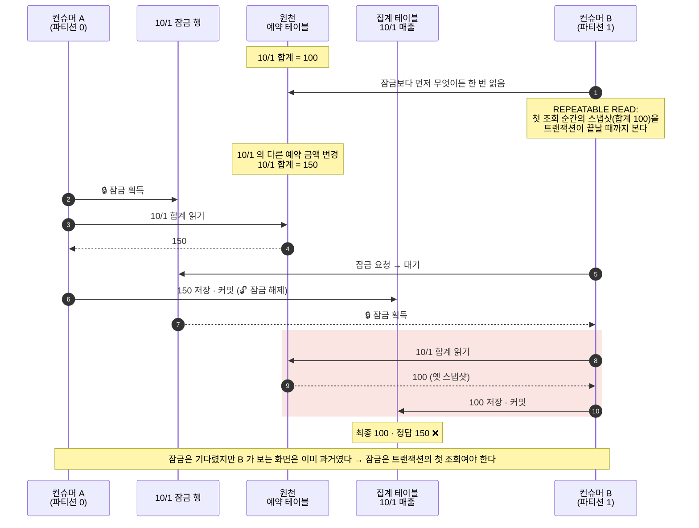

# retro-kafka-statistic

실무에서 만든 **CDC → Kafka → 집계** 파이프라인을 회고하며,
재직 중 알게 됐지만 퇴사 전에 고치지 못한 **stale write** 를 직접 재현하고 막아 본 실습 저장소.

> **핵심 세 줄**
> - 파티션 키(예약 ID)는 **같은 예약**의 순서만 보장한다. 집계 단위(날짜)가 다르면 두 컨슈머가 **같은 집계 row 를 동시에** 쓴다.
> - "원천 재조회 + 절대값 upsert" 는 중복·역순 도착에는 안전하지만 이 동시 쓰기에는 안전하지 않다. 누락 0 · 재처리 0 · lag 0 이어도 집계가 틀린다.
> - 잠금은 최신값이 아니라 **순서**를 보장한다. 그래서 잠금은 트랜잭션의 **첫 조회**여야 하고, **모든 쓰기 경로**가 같은 규칙을 지켜야 한다.

- Kafka 1대 (KRaft) · MySQL 8.4 · Python (confluent-kafka, PyMySQL)
- 포트: Kafka 19092 · Kafka UI 18080 · MySQL 13306

---

## 1. 출발점 — 실무에서 만든 구조

예약이 바뀔 때마다 그 예약이 속한 날짜의 매출 집계를 다시 계산해, 대시보드가 바로 조회하게 하는 파이프라인이었다.



설계의 중심은 두 가지였다.

- **이벤트는 "바뀌었다"는 알림으로만 쓴다.** 페이로드 값은 쓰지 않고 원천을 다시 읽는다.
- **증분 가감이 아니라 절대값으로 덮어쓴다.** 같은 원천 상태에서는 몇 번을 실행해도 같은 값이 된다.

그리고 이렇게 가정했다.

> 파이프라인 앞단이 순서·중복을 보장하지 않아도, 집계 결과는 원천 DB 의 현재 상태로 항상 수렴한다.

재직 중 Kafka 를 더 깊이 공부하면서 이 가정에 빈틈이 있다는 것을 알게 됐다.
반영하려 했지만 퇴사 전에 마무리하지 못했다.
이 저장소는 그 빈틈을 재현하고, 고쳤다면 어떻게 고쳤을지를 끝까지 검증한 기록이다.

## 2. 실무 → 랩 대응

| 실무 | 랩 | 공통점 |
| --- | --- | --- |
| 일 단위 집계 row | 행사(`event_code`) 집계 row | 여러 예약이 한 집계 row 로 모인다 |
| 파티션 키 = 예약 ID, 파티션 2 | 동일 | 같은 집계 키의 예약이 여러 파티션으로 흩어진다 (C1: 같은 행사 EXPO-02 가 p0·p1 로 갈라짐) |
| 파티션별 동시 컨슈머 | 워커 2개 ([app/aggregate.py](app/aggregate.py)) | 같은 집계 row 를 동시에 재계산할 수 있다 |
| 복구 쿼리 | 복구 배치 ([app/recover.py](app/recover.py)) | 컨슈머 밖의 또 다른 쓰기 경로 |
| MariaDB | MySQL 8.4 | InnoDB 잠금·스냅샷 동작 기준 (MariaDB 버전 차이는 미검증) |

## 3. stale write — 가정이 틀린 부분

**stale write**: 오래된 읽기에 근거한 쓰기가 더 최신의 쓰기를 덮어쓰는 것.

### 원인: 파티션 키 단위 ≠ 집계 단위

- 파티션은 `hash(예약 ID) % 파티션 수` 로 정해진다. **같은 예약**은 항상 같은 파티션 → 같은 컨슈머로 가서 순서대로 처리된다.
- 하지만 해시는 날짜를 모른다. **같은 날짜의 다른 예약**은 다른 파티션 → 다른 컨슈머로 갈 수 있다.
- 집계 row 는 날짜 단위다. 그래서 두 컨슈머가 **같은 날짜 row 를 동시에 재계산**한다.

원천 재조회는 "**읽는 시점**"의 최신값을 줄 뿐, "**쓰는 시점**"의 최신값을 보장하지 않는다.



랩 결과 (K1, 워커 2개 · 잠금 없음): **누락 0, 재처리 0, lag 0 인데 집계 MISMATCH.**

### 실제로 얼마나 생기나

- **확률은 낮다.** 읽기와 쓰기 사이의 틈은 보통 짧다. 랩에서도 `--hold-after-read-ms` 로 틈을 일부러 늘려 재현했다.
- **조건이 겹치면 커진다.** 같은 날짜(오늘)로 변경이 몰릴 때, 배치 처리로 읽기와 쓰기 사이가 벌어질 때.
- **생기면 발견하기 어렵다.** 컨슈머 지표에는 아무 이상이 없다. 틀린 값은 그 날짜에 다음 변경이 올 때까지 남고, 변경이 더 없는 날짜라면 계속 틀린 채로 남는다.

## 4. 해결 — 집계 키별 잠금

집계 키마다 제어 행(`event_lock`)을 두고, 재계산 전에 `SELECT … FOR UPDATE` 로 잡는다.



### 함정: 잠갔는데도 옛 값을 쓴다

잠금 전에 **무엇이든 한 번 읽으면**, REPEATABLE READ 의 스냅샷이 그 시점에 고정된다 (s3).



구현은 [app/db.py](app/db.py) 의 `recompute_event(lock=True)` 하나다. 잠금 → 원천 조회 → 절대값 upsert 순서를 이 함수가 강제한다.
위 시나리오들은 [app/stale.py](app/stale.py) 가 hook 지점에서 두 트랜잭션의 순서를 고정해 매번 같은 결과로 재현한다.

## 5. 설계 결정과 이유

| 결정 | 왜 | 근거 실험 |
| --- | --- | --- |
| 파티션 키 = 예약 ID | 이벤트의 주인은 예약이다. 같은 예약의 변경 순서가 보장돼야 한다 | C1 |
| 증분이 아니라 원천 재조회 + 절대값 upsert | 같은 이벤트가 여러 번 와도 결과가 같다 → 재처리가 무해하다. C2 전체에서 중복 누적은 0건 | E2 |
| 집계 키별 **비관적** 잠금 | 예약 ID 키로도 서로 다른 예약이 같은 집계 row 를 쓰는 것은 못 막는다. 낙관적 잠금은 낡은 것이 집계 row 가 아니라 **원천 읽기**라서 원천 쪽 버전이 필요한데, 집계 재료가 여러 테이블에 흩어져 있어 정의하기 어렵다 | K1 → K2 |
| 잠금 대상은 별도 제어 행(`event_lock`) | 집계 row 가 아직 없는 새 키도 잠글 대상이 항상 있어야 한다 | — |
| 잠금을 트랜잭션의 첫 조회로 | 스냅샷은 첫 일반 SELECT 시점에 고정된다. 잠금 전에 읽으면 잠가도 옛 값을 쓴다 (READ COMMITTED 로도 해결되지만 격리 수준은 세션·DB 설정이라 놓치기 쉽고, 조회 순서는 코드에서 강제할 수 있다) | s3 → s3b |
| 모든 쓰기 경로가 같은 함수를 거친다 | 복구 쿼리 하나만 규칙을 어겨도 옛 값으로 덮인다 | R1 → R1b |
| 잠금 대기 타임아웃 시 커밋 없이 정지 | 틀린 값보다 늦은 값이 낫다. 미커밋 구간은 재처리로 복구된다 | K3 |
| 제어 행 존재 확인은 잠금 없는 SELECT | `INSERT IGNORE` 가 공유 잠금을 요청해 업무 쓰기가 집계 잠금에 막혔다 | — |

## 6. 비용과 한계, 그리고 다시 만든다면

비용:

- 같은 키로 부하가 몰리면 키 단위 직렬화가 **처리량 상한**이 된다.
- 잠금을 쥔 동안 **DB 연결을 점유**한다.

실무에 반영한다면 (✅ 랩에서 검증 / ⬜ 미검증):

- ✅ 날짜별 제어 행 `FOR UPDATE` 를 트랜잭션의 첫 조회로 둔다.
- ✅ 복구 쿼리도 같은 재계산 함수를 거치게 한다.
- ✅ 잠금 대기 타임아웃 시 커밋하지 않고 배치를 실패시킨다 → 재처리.
- ⬜ 잠금 대기 타임아웃을 컨슈머(함수) 실행 제한보다 짧게 둔다.
- ⬜ 정합성 모니터링은 lag 가 아니라 **원천 재계산 대조**로 한다.

## 빠른 시작

판정은 로그가 아니라 원천 DB 에서 독립 계산한 기대값과 실제 집계를 대조해서 한다 ([app/verify.py](app/verify.py)).

```powershell
docker compose up -d
uv sync
uv run python -m app.admin bootstrap
uv run python -m app.produce
uv run python -m app.aggregate --group demo --idle-exit 4
uv run python -m app.verify --group demo

uv run python -m app.stale all   # stale write 시나리오 s1 ~ s3b 재현
```

## 더 보기

- [notes/results.md](notes/results.md) — C1·C2·C4 실험 결과 상세 (전체 실험 표)
- [notes/commands.md](notes/commands.md) — 구성, 디렉터리, 실습별 명령과 실험 인자
- 남은 과제: C3 재시도·DLQ, C5 Kafka 트랜잭션 / Exactly-once
